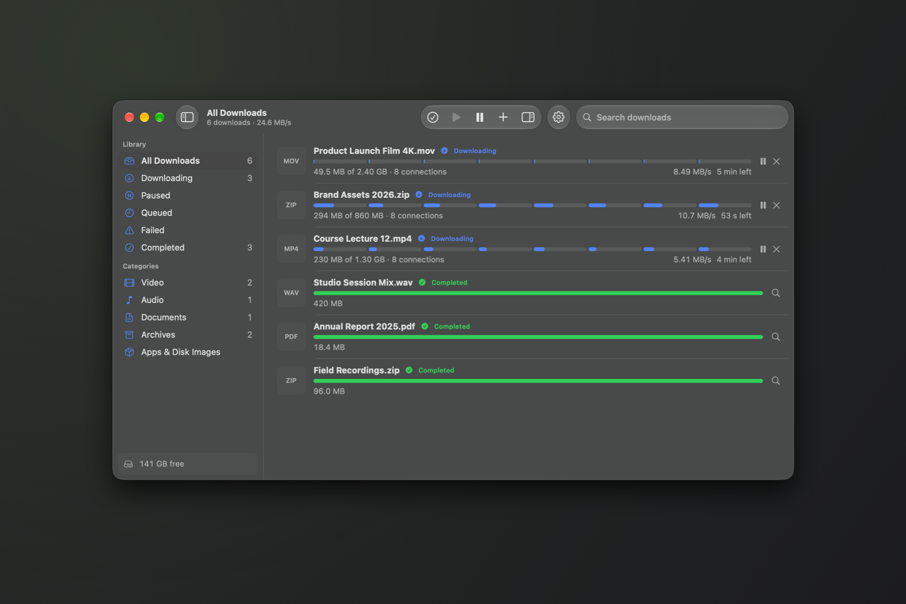
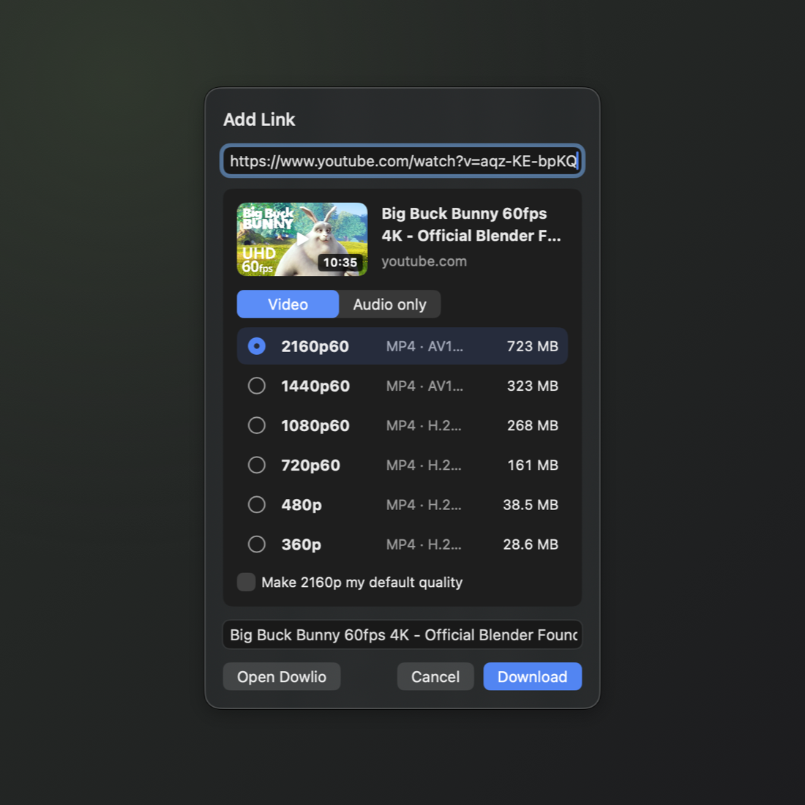
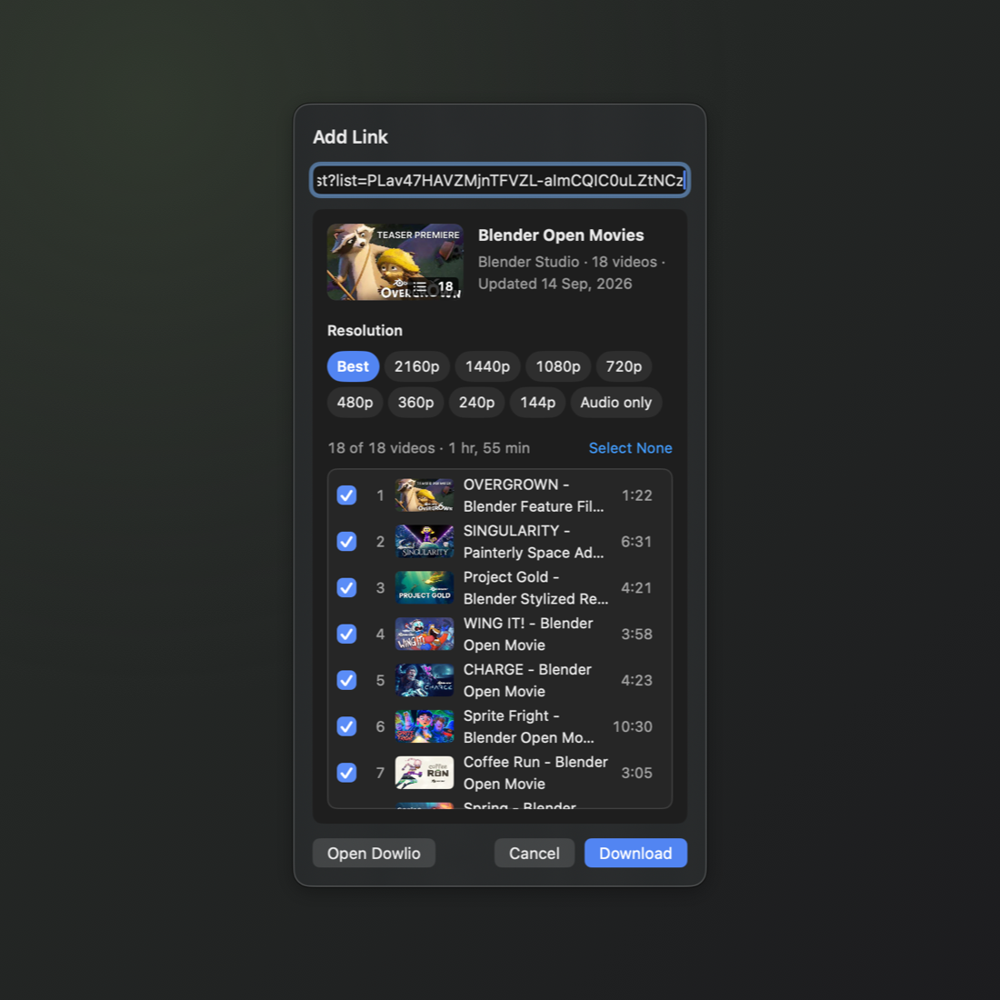
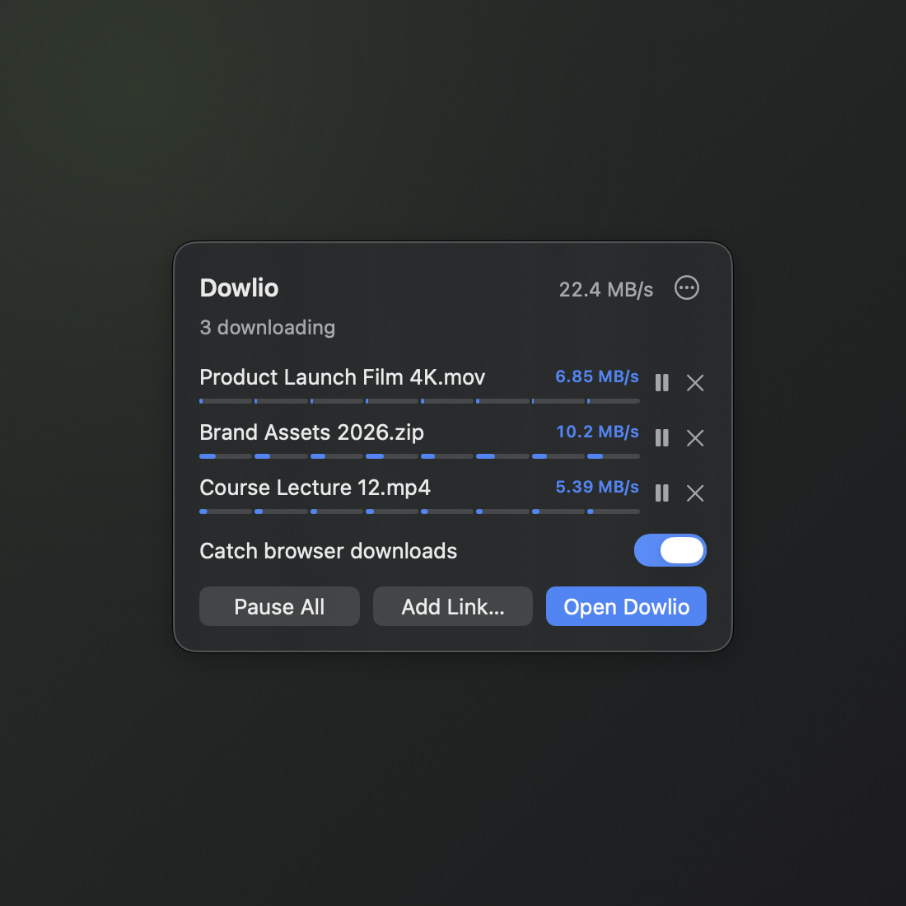
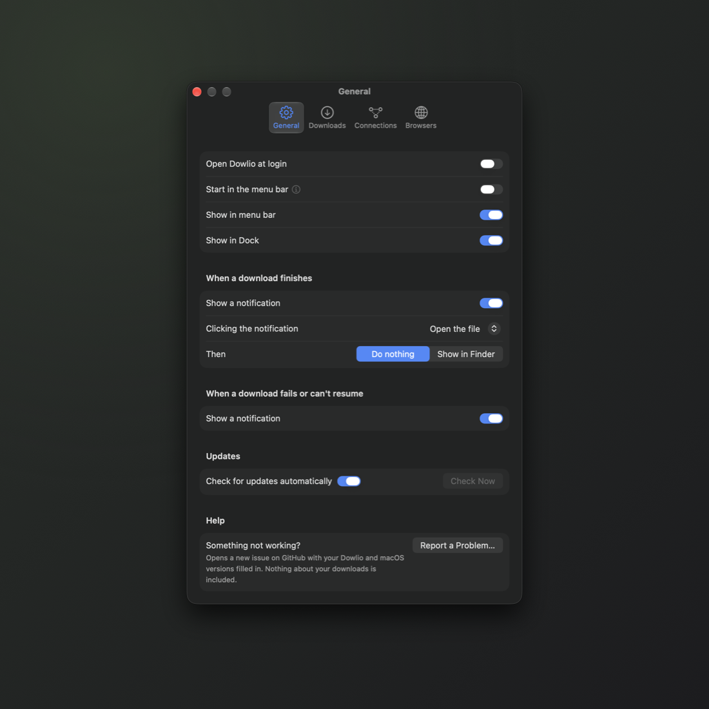

# &nbsp;&nbsp;Dowlio

*A fast, private, native download manager for Mac*

  

Dowlio splits each download across several connections, so large files arrive faster. It catches the downloads you start in your browser, finds the video on almost any page, and keeps going after you close the window or quit.

---

## 📥 Install

1. Download `Dowlio-<version>.dmg` from the [latest release](../../releases/latest) and drag Dowlio to Applications.
2. Open Dowlio. macOS says it can't verify the app, because Dowlio isn't notarized yet. Click Done.
3. In System Settings › Privacy & Security, click Open Anyway next to the message about Dowlio.

Dowlio needs macOS 14 or later and runs on Apple silicon and Intel Macs. It updates itself after that. If you paired a browser, allow the one-time keychain prompt after each update so it stays paired.

---

## ✅ What it does

- **Faster downloads.** Up to 16 connections per file, each segment shown on the progress bar.
- **YouTube and hundreds of sites.** Pick any resolution up to 2160p60, or Audio only. Whole Playlists and YouTube Music albums download in one go.
- **Catches browser downloads.** With Dowlio Connect, downloads you start in Chrome, Arc, Brave or Edge finish in Dowlio.
- **Pause, quit, resume.** Unfinished downloads come back after a quit, and expired YouTube links refresh on their own.
- **Lives in the menu bar.** Add a link, watch progress and pause without opening the window.
- **Sorted for you.** Video, Audio, Documents, Archives and Apps & Disk Images, each searchable.

<table>
  <tr>
    <td></td>
    <td></td>
  </tr>
  <tr>
    <td></td>
    <td></td>
  </tr>
</table>

---

## 🌐 Dowlio Connect

Dowlio Connect is Dowlio's extension for Chromium browsers. It isn't in the Chrome Web Store yet, so you add it yourself in about a minute:

1. In Settings › Browsers, choose Add next to your browser. Dowlio opens its extensions page and shows a folder path.
2. Turn on Developer mode, click Load unpacked, and choose that folder.
3. Type the 6-digit code Dowlio shows into the Dowlio Connect popup.

After that, downloads move to Dowlio as they start. Press ⌥⇧D on any page to send its videos to Dowlio.

---

## 🔒 Privacy

- No account, no tracking. Dowlio talks to the sites you download from, and to GitHub for updates.
- Cookies from your browser stay in memory for the one download that needs them, and go only to their own site.
- YouTube support uses [yt-dlp](https://github.com/yt-dlp/yt-dlp) and [QuickJS-NG](https://github.com/quickjs-ng/quickjs). Dowlio asks before downloading them and checks each one before it runs.

---

## 🛠️ Feedback

Found a problem? Choose Report a Problem in Settings or the menu bar, or [open an issue](../../issues).

## ⚖️ License

Copyright © 2026 Ifty Rahman. All rights reserved. The source is public to read, but no license to reuse it is granted yet.
